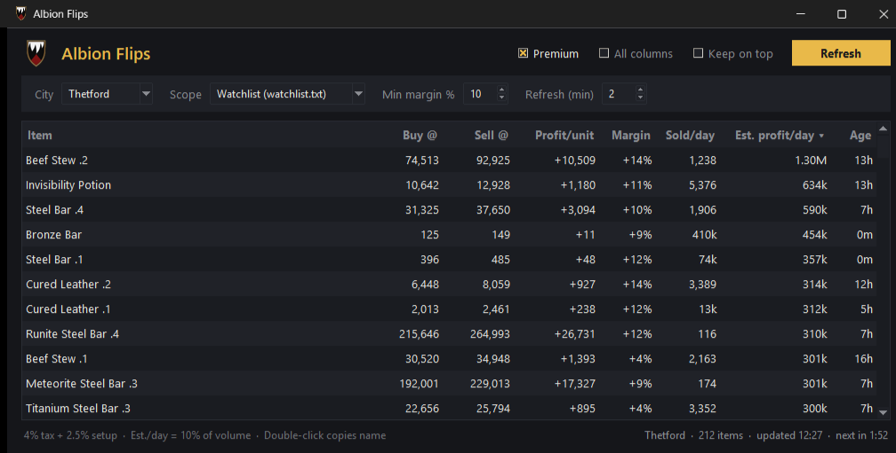

# Albion Flips

A small Windows app that finds market flips in Albion Online: items you can buy with a buy order and resell with a sell order in the same city, after fees.

Americas server only. Prices come from the [Albion Online Data Project](https://www.albion-online-data.com/).



## Download

Grab `AlbionFlips.zip` from the [latest release](../../releases/latest), extract it, and run `AlbionFlips.exe`. The included `README.txt` covers setup and common problems.

The exe isn't code-signed, so Windows will show "Windows protected your PC" the first time. Click **More info**, then **Run anyway**.

## What it shows

| Column | Meaning |
|---|---|
| Buy @ / Sell @ | Suggested buy-order and sell-order prices. Sell @ is capped at the 7-day average. |
| Profit/unit | Sell @ minus Buy @, after 2.5% setup on each order and sales tax (4% with Premium, 8% without). |
| Margin | Profit/unit as a share of what you pay. |
| Sold/day | Average units sold per day over the last 7 days. |
| Est. profit/day | Profit/unit times 10% of daily sales, a rough guess at what one trader can fill. |
| Age | How old the price is. The data is crowd-sourced, so check in game before you buy. |

Tick **All columns** for live bid/ask, the 7-day average and the capital each flip ties up.

## The watchlist

`watchlist.txt` sits next to the app and lists the items to check: one in-game name per line, with `.1` to `.4` for enchants (`Beef Stew .1`, `Steel Bar .4`). It ships with food, potions and every crafting material, grouped into sections so you can trim it. Lines starting with `#` are skipped, and misspelled lines are listed in a yellow bar so you can fix them.

The **Scope** menu can also scan whole categories instead of the watchlist.

## Run from source

Needs Python 3.10+ on Windows. No extra packages.

```
python flip-widget.py
```

`python flip-widget.py --selftest` runs one scan and prints the top rows.

To build the exe yourself:

```
pip install pyinstaller
powershell -File build.ps1
```

The zip ends up in `dist/`.

## How it uses the API

Each refresh fetches current prices for the watchlist (about 4 requests for the full list). The 7-day history is cached for 30 minutes, responses are gzip-compressed, and the app backs off when it's rate limited. That keeps it well under the project's limits of 180 requests a minute and 300 every 5 minutes.

## Credits

- Market data: [Albion Online Data Project](https://www.albion-online-data.com/)
- Item names (`items.txt`): [ao-bin-dumps](https://github.com/ao-data/ao-bin-dumps)

Albion Online is a trademark of Sandbox Interactive GmbH. This project isn't affiliated with or endorsed by Sandbox Interactive. It only reads the public market API and never touches the game client.

## License

[MIT](LICENSE)
